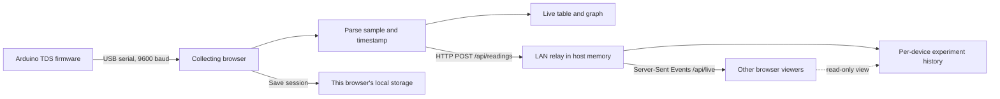

# Scalar TDS Lab

Scalar is a responsive dashboard for viewing total dissolved solids (TDS) readings from an Arduino. A browser connected to the Arduino reads its USB serial stream. The app shows the current value, a live graph, and the latest five readings. Other people on the same local network can follow the live experiment from their own devices.

The app uses React, TypeScript, and Vite. It has no login and no persistent server-side database.

## What is implemented

- **Arduino serial input:** Web Serial opens a user-selected port at 9600 baud and parses Scalar TDS rows.
- **TDS dashboard:** The main view shows TDS, optional temperature, elapsed session time, and a graph of the current run.
- **TDS unit selector:** Choose ppm or mg/L. For dilute water samples, the app displays the same numeric value under either label because these units are approximately equivalent in that range. It does not perform a concentration conversion. [USGS unit guidance](https://pubs.usgs.gov/wri/1985/4220/report.pdf).
- **Five-row live queue:** The local table shows the newest five samples, ordered oldest to newest. A new sample appears at the bottom and rolls the oldest row off the top. The active session still retains the full run for its graph and export.
- **LAN live sharing:** Every browser tab has a temporary source ID. Readings are relayed to the host and sent to connected viewers using Server-Sent Events. Multiple sources appear as separate experiments, each with its own graph and expandable full reading table.
- **Device-local logging:** Saving a session writes it to the collecting browser's local storage. The other devices' network view is read-only; they do not receive a local saved copy automatically.
- **CSV and TXT export:** Export the current or saved session, or export all saved sessions. CSV uses commas; TXT uses tabs. Exports include local receive time, Arduino uptime, TDS, and optional temperature.
- **Help section:** The in-app guide explains network access, Arduino connection, graphs, save/export behavior, and the serial line format.
- **Responsive layout:** The dashboard adapts to laptop, tablet, and phone screens. Arduino connection itself depends on device and browser support.

## How the live data moves



## Run the app

### Development on a local network

Install dependencies once:

```sh
npm install
```

Start Vite and the built-in LAN relay:

```sh
npm run dev
```

Use the exact address Vite prints in the terminal on the host computer. It normally starts at `http://localhost:5173`; if that port is already occupied, Vite selects another port (for example, 5174). On other devices using the same Wi-Fi, use Vite's printed network address or replace `localhost` with the host computer's LAN IP. The host computer must remain on and the development server must remain running while viewers use the live feed. A firewall may need to allow connections to Vite's port.

### Production server

```sh
npm run build
npm start
```

The Node server serves the generated `dist` directory and the LAN API on port 4174 by default. Set the `PORT` environment variable to change the port. For access outside a trusted lab network, deploy behind HTTPS. Web Serial requires a secure context and is currently supported mainly in desktop Chromium browsers such as Chrome and Edge. The Arduino must be plugged into the device that selects **Connect Arduino**; other network devices can view the stream without a serial port.

## Arduino serial format

Use **9600 baud** and send one UTF-8 line per sample, terminated by a newline:

```text
SCALAR,1,1240,245.50,24.8
```

The fields are:

| Field | Meaning | Example |
| --- | --- | --- |
| `SCALAR` | Protocol marker | `SCALAR` |
| `1` | Protocol version | `1` |
| `1240` | Arduino uptime from `millis()`, in milliseconds | `1240` |
| `245.50` | Calibrated TDS reading, in ppm | `245.50` |
| `24.8` | Optional temperature, in degrees Celsius | `24.8` |

The browser records its own local receive time as well as Arduino uptime. This lets viewers compare when readings arrived while retaining the board's elapsed time for each sample. Send an empty final field if temperature is unavailable, for example `SCALAR,1,1240,245.50,`.

### Serial test sketch

[`arduino/scalar_serial_test.ino`](arduino/scalar_serial_test.ino) emits smooth synthetic values once per second using the same protocol. Use it to check serial transport, the rolling queue, chart, network viewers, local save, and exports before sensor calibration. It **does not measure TDS**. The actual probe circuit, conversion method, and calibration must supply the firmware's `tds_ppm` value.

## Data and privacy model

- The host relay holds live experiments and their readings in memory only. Restarting the relay clears that shared history.
- Each browser tab has a separate temporary source identity, so readings from separate devices form separate experiments.
- A session saved from the collecting browser is stored only in that browser's local storage. Clearing that browser's site data removes it.
- Network viewers can see the complete in-memory live experiment history but cannot save it into the source browser's local log. Use an exported file to transfer a saved session.
- There is no login or network access control. Anyone who can reach the app on the LAN can view the live feed. Use it on a trusted lab network.

## Project structure

```text
src/
  App.tsx                       Dashboard and experiment workflows
  components/Sparkline.tsx      TDS graph
  domain/types.ts               Reading, session, and shared experiment types
  services/measurements.ts      Serial parser and TDS unit display
  services/serialDevice.ts      Web Serial connection
  services/sessionRepository.ts Device-local session persistence
  services/sharedFeed.ts        LAN event stream and reading publisher
server/
  liveFeed.mjs                  In-memory HTTP/SSE relay
  index.mjs                     Production static/API server
arduino/
  scalar_serial_test.ino        Synthetic serial protocol test sketch
```

The standalone LaTeX source is [`docs/scalar_documentation.tex`](docs/scalar_documentation.tex). Compile it from the `docs` folder with `pdflatex scalar_documentation.tex`; run the command twice to populate the table of contents and cross-references.

