# Scalar UI: install and run it on Windows

This guide is for the Windows computer that will host the lab dashboard. You do not need to type commands. The installer prepares the app once; after that, use the desktop shortcuts to start and stop it.

## Before you begin

- A Windows 10 or 11 computer, and permission to install Node.js if it is not already installed.
- Internet access for the first setup (the installer downloads Node.js if needed and the project packages).
- The Scalar project folder extracted to a permanent location. Do not move it after installation because the desktop shortcuts point to that folder.
- For measurements: the Arduino, USB cable, and Chrome or Edge on the host computer. Viewers can use another modern browser on the same Wi-Fi.

> **Important:** Keep the project folder together. Do not run the installer from inside a ZIP preview. Extract the ZIP first, then open the extracted folder.

## First-time installation

1. **Open the project folder.** If you received a ZIP, right-click it, choose **Extract All...**, and open the extracted `CHE381 Term Project` folder. Run the installer from this extracted folder, not from the ZIP preview.

   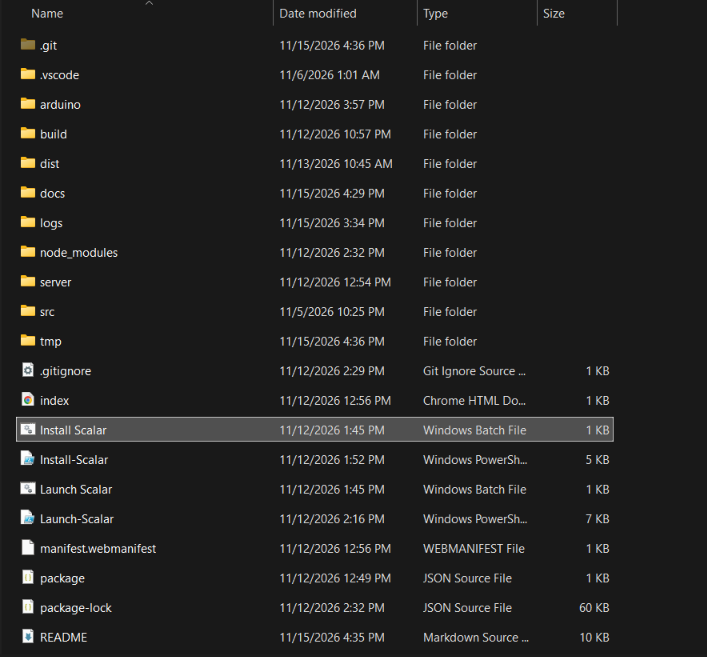

2. **Run the installer.** In File Explorer, select the row named **Install Scalar** with type **Windows Batch File** and double-click it. Windows may hide the `.bat` extension.
3. **Approve Windows setup prompts.** If User Account Control asks whether to allow the Node.js installer to make changes, choose **Yes** to continue with the installation you started.
4. **Wait for setup to complete.** The console checks Node.js 20 or later, installs Node.js LTS if needed, installs project packages, builds the dashboard, and creates the two desktop shortcuts. Keep the internet connection on.

   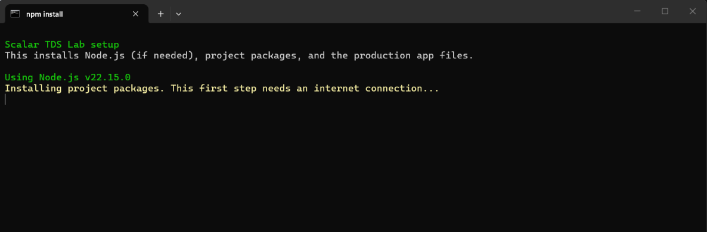

   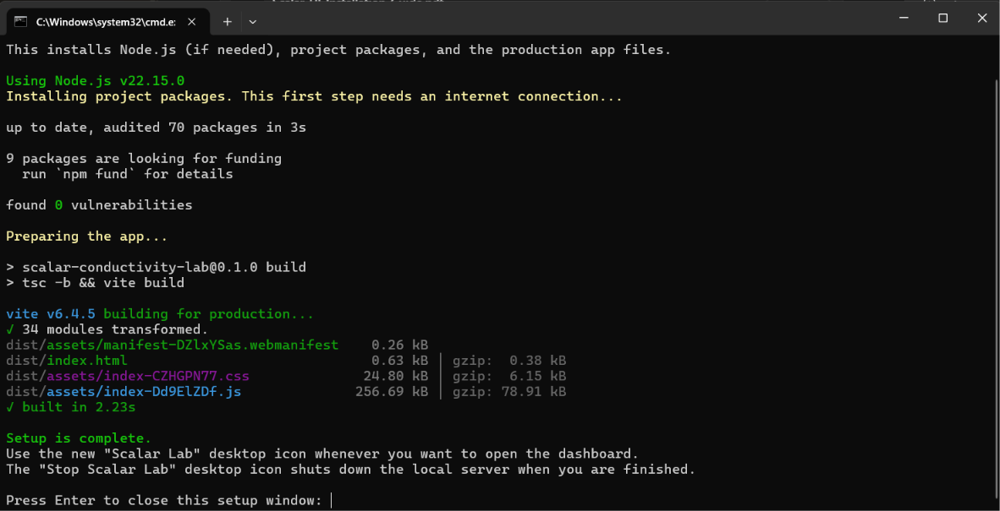

5. **If Node.js setup needs help:** when Windows Package Manager (`winget`) is unavailable, the installer opens the official [Node.js download page](https://nodejs.org/en/download). Install the current LTS Windows version, then run **Install Scalar** again.
6. **Close setup and check the desktop.** When setup says it is complete, press Enter. You should see both **Scalar Lab** and **Stop Scalar Lab** shortcuts.

   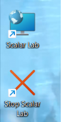

## Start the dashboard

1. Connect the Arduino to the host computer with USB. For a no-hardware practice run, you can skip this and open the dashboard first.
2. Double-click **Scalar Lab** on the desktop. A console checks for an existing server, starts one on an available port, opens the browser, and prints the addresses to use.

   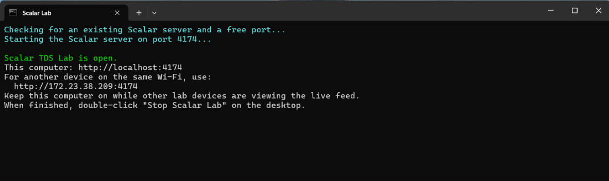

3. A **Scalar TDS Lab is ready** dialog confirms the browser opened and repeats the host and viewer addresses. Click **OK** to close this dialog; keep the host computer on while the lab runs.

   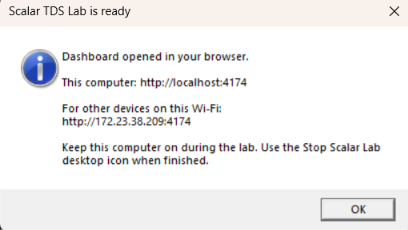

4. Your default browser opens the dashboard. In the **Overview** page, click **Connect Arduino** in desktop Chrome or Edge on the host computer, then choose the Arduino's serial port.

   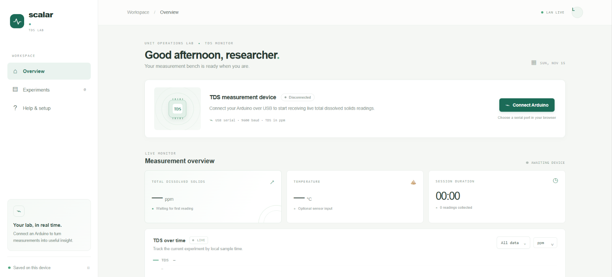
5. For a live Arduino run, choose the correct USB/serial port in the browser's device picker and approve the connection. The dashboard begins a session when readings arrive.
6. For a practice run, load `arduino/scalar_serial_test.ino` onto a compatible Arduino and connect it. This sketch sends synthetic values for checking the graph, queue, network view, save, and export. **It is not a sensor and does not measure TDS.**

### What the screen shows

When readings arrive, the dashboard shows the TDS value, graph, latest five readings, and session controls. The active local session retains all readings for its graph and export.

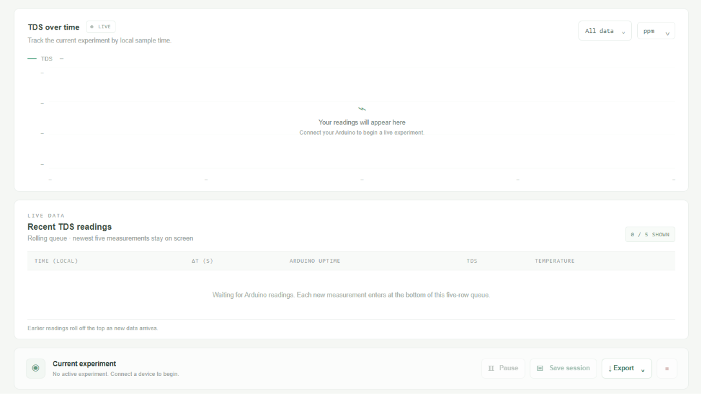

Click **Save session** to keep readings in this browser's local storage, or use **Export** to download CSV/TXT data. Saving is device-local; it does not copy a session to network viewers.

## Let others view the live run

1. Leave Scalar running on the host computer.
2. In the launcher's status window, copy one of the **For another device on this Wi-Fi** addresses. It looks like `http://192.168.1.25:4174` (your address and port may differ).
3. On each viewer device, join the same lab Wi-Fi and open that full address in a browser.
4. If Windows Firewall asks whether Node.js may communicate on a network, allow it on the **Private network** only. Do not enable it for Public networks. The Wi-Fi must allow devices to reach one another; guest Wi-Fi commonly blocks this.

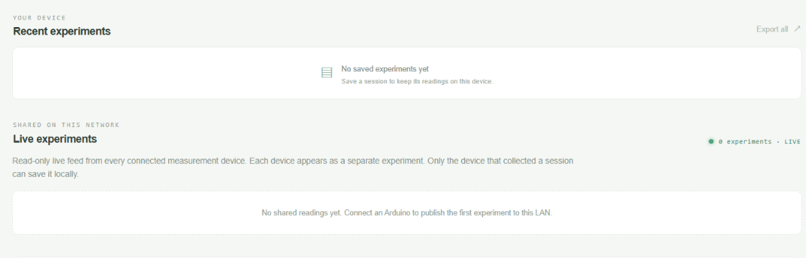

Viewers get a read-only live feed. They cannot select the host's Arduino or save the host browser's session. Anyone who can reach the address on the local network can view the feed, so use a trusted lab network. Do not expose this unauthenticated app to the public internet.

## End a lab session

1. Save or export any readings you need in the host browser.
2. Double-click **Stop Scalar Lab** on the desktop. A message confirms that the local server has stopped. If it says Scalar is not currently running, the server is already stopped; dismiss the message with **OK**.

   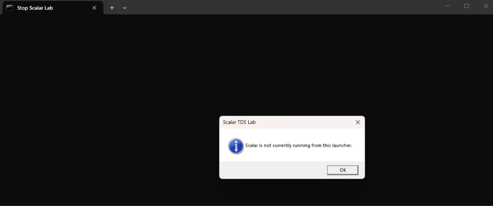

3. You can start another session later by double-clicking **Scalar Lab** again.

## Troubleshooting

The dashboard's **Help & setup** page also summarizes the workflow and Arduino serial line format.

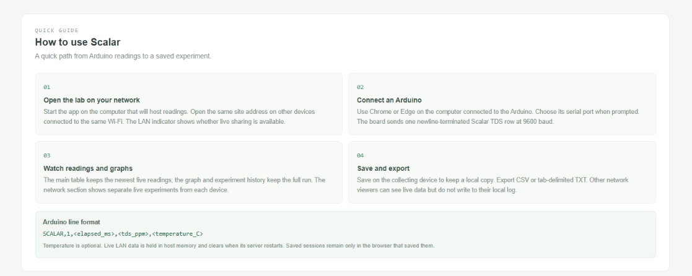

| What you see | What to do |
| --- | --- |
| Setup says `winget` is missing | Install Node.js LTS from [nodejs.org](https://nodejs.org/en/download), then run **Install Scalar.bat** again. |
| Browser says `Forbidden` | Double-click **Stop Scalar Lab**, then start **Scalar Lab** again. |
| Server could not start | Open the `logs` folder inside the project. Check `scalar-server-error.log`, then `scalar-server.log`. |
| Ports 4174-4194 are in use | Close another Scalar instance or ask lab IT for help. |
| Viewer cannot open the address | Keep the host on, check both devices use the same Wi-Fi, copy the address shown by the launcher, and allow Node.js on the Windows Private network if prompted. |
| Arduino is not listed | Connect it to the host by USB and use desktop Chrome or Edge. Close other apps using the serial port and try again. |
| No readings arrive | Confirm the selected port, firmware baud rate (9600), and line format. The dashboard's Help section describes the serial protocol. |

## Optional: run from source

For development only, install Node.js 20+, open a terminal in the project folder, run `npm install`, then `npm run dev`. Vite prints the local development URL. The desktop installer is the recommended lab workflow because it builds and starts the production app.

## Related files

- [Project overview](../README.md)
- [Windows installer](../Install%20Scalar.bat)
- [Start shortcut target](../Launch%20Scalar.bat)
- [Stop shortcut target](../Stop%20Scalar.bat)
- [Synthetic Arduino serial test sketch](../arduino/scalar_serial_test.ino)
